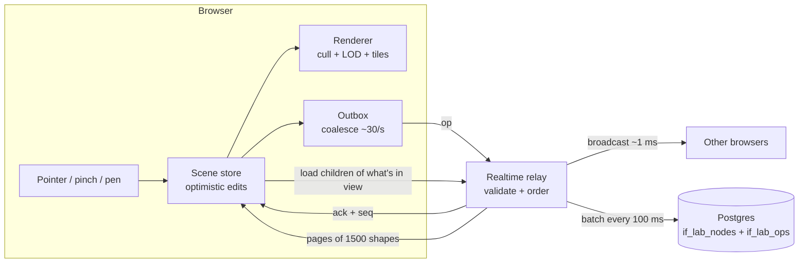

# Nested engine: architecture

The goal: one shared world of SVG shapes nested inside each other with no depth
limit, where many people zoom, draw and move things at the same time and
nothing ever pauses or jitters. Think interactive art installation, not web form.

This lab proves the architecture at scale before any of it goes into
`app/index.html`. Everything here is plain, readable source.

## The four rules that make it smooth

1. **No global coordinates.** Every shape stores only its position, scale and
   rotation relative to its parent (`x, y, s, r`) plus its own outline in local
   units. A shape 44 levels down is ~10^-30 the size of the world, which no
   number format can represent globally. Locally it's just `s = 0.2`.
2. **The camera lives inside whatever you're looking at.** The camera is
   expressed in the local frame of an "anchor" shape (the one filling your
   view). Zoom deep enough into a child and the camera re-expresses itself in
   the child's frame; zoom out and it climbs back up. The numbers the renderer
   sees always stay small, so edges are pixel-exact at any depth.
   (`public/src/camera.js`, tested 80 levels / 10^-42 deep.)
3. **Draw only what's visible, at the detail that's visible.** Each frame walks
   the tree from the top, skipping off-screen branches and anything under a
   pixel. Dense regions use a spatial grid, and regions with thousands of
   children are drawn from cached image tiles (like a map). Frame time is
   watched; under load, the smallest detail fades first instead of the frame
   rate dropping. (`public/src/renderer.js`)
4. **The network and the database are never on the screen's critical path.**
   Your edits apply instantly on your screen. They're sent ~30 times a second,
   relayed to everyone else within a millisecond, and written to Postgres in
   batches every 100 ms. Shapes you're about to zoom into are fetched before
   they're big enough to notice, and applied a slice per frame.

## Data model (`sql/schema.sql`)

| Column | Meaning |
|---|---|
| `id`, `parent`, `depth` | Tree structure. Deleting a shape deletes everything inside it (cascade). |
| `x, y, s, r` | Transform relative to the parent. Moving a whole region is one row update. |
| `pts`, `rings`, `smooth`, `rule` | The outline in local units. One or more rings; smooth curves or flattened SVG paths; nonzero or even-odd fill. |
| `fill`, `anim`, `clip` | Color, optional animation (`hue`, `pulse`, `spin`, `orbit`), and whether children are clipped to this shape. |
| `nchild` | Kept by a trigger, so a client knows a region has children to fetch without counting them. |
| `v` | Sequence number of the last change, for conflict resolution. |

`if_lab_ops` is an append-only log of every change. History, undo, replay and
"frames" in time all come from here.

## Collaboration model

* The relay gives every change a sequence number. Conflicts resolve **per
  field, last writer wins, in sequence order**, so two people can recolor and
  move the same shape at once and both changes survive.
* While you're dragging, other people's changes to *those same fields* are held
  aside instead of applied, so your shape never jitters under your finger. When
  your edit is confirmed, anything newer is applied. Everyone ends up with the
  same state. (`public/src/scene.js`, tested in `test/engine.test.mjs`.)
* Presence (cursors, selections, where people are looking) is relayed but never
  stored. Cursors are sent relative to the shape under them, so you see other
  people's cursors in the right place even when you're zoomed to a different
  depth. "Follow" flies your camera to whatever someone else is looking at.
* Animations are computed from a shared clock, never sent over the network, so
  everyone sees the same motion at zero bandwidth.

## Mapping to Supabase

The lab server (`server/server.mjs`) is a stand-in for what Supabase provides:

| Lab piece | Supabase equivalent |
|---|---|
| Postgres + `sql/schema.sql` | Same schema, unchanged, with the RLS block at the bottom enabled |
| `load` (children by parent, paged) | PostgREST query on `(parent, ord)` |
| `path` (ancestors for deep links) | RPC `if_lab_path(id)` (already in the schema) |
| Relay + batched writes | Realtime **Broadcast** channel per world + a batched, security-definer RPC `if_lab_apply_ops(ops jsonb)` |
| Presence | Realtime **Presence** |

**Recommendation:** keep Supabase for the database, sign-in and file storage,
and run the relay as its own small service (this server, about 250 lines) for
the live installation. A dedicated relay gives one ordering authority,
validates every edit before anyone sees it, and keeps the database off the hot
path. A Supabase-only version (Broadcast for live edits, clients persisting
through the RPC, timestamps instead of server sequence numbers) is a smaller
step and works fine for a handful of people. The client doesn't care which:
`net-ws.js` and `net-local.js` share one small interface, and a
`net-supabase.js` would be a third implementation of it.

## Measured (headless Chromium, 4 CPU cores, no GPU)

| Scenario | Result |
|---|---|
| Whole world on screen | 60 fps, render 2.5 ms (p95), 0 frames over 33 ms |
| Camera flight down 44 levels (10^29.9× zoom), loading as it goes | 59.6 fps over 17.5 s, 1 frame over 33 ms |
| 20,000-star galaxy region, flying across it | render 7.4 ms (p95), slowest frame 48 ms |
| 15 bots + 2 browser viewers editing at once (480 edits/s) | edit visible on another screen in 55 ms (p50), 113 ms (p95); 0 server errors; Postgres flush ~4 ms per batch |

The galaxy's frame rate in this test (~40 fps) is limited by the test
machine's software rasterizer, which costs ~19 ms per frame even with nothing
drawn. Phones and laptops rasterize canvas on the GPU. These are not phone
measurements yet; run `npm run bench` against a phone-sized viewport on real
devices before trusting them for the installation.

## Known limits and next steps

1. **Rendering backend:** Canvas 2D is the ceiling for very dense scenes. The
   renderer's structure (cull, LOD, tiles) carries over to WebGL/WebGPU
   unchanged; only the "draw a path" calls change.
2. **Binary wire format:** loads are JSON with per-message compression. A
   binary encoding (Float32 outlines) would cut load size ~4× for dense
   regions. Decoding could also move to a Web Worker.
3. **Tile invalidation:** editing one star in a 20,000-star region rebuilds the
   visible tiles (progressively, with the old tiles shown meanwhile).
   Dirty-rectangle invalidation would rebuild only the tile that changed.
4. **Moving a shape to a new parent** (reparenting) isn't exposed yet. The
   schema supports it (the `nchild` trigger handles `parent` updates).
5. **Undo/history UI** on top of `if_lab_ops`.
6. **Porting into `app/index.html`:** the camera (`camera.js`), scene store
   and renderer are the pieces to port. The safest route is to replace the
   original app's viewport/quadtree module with these, keeping its UI.
